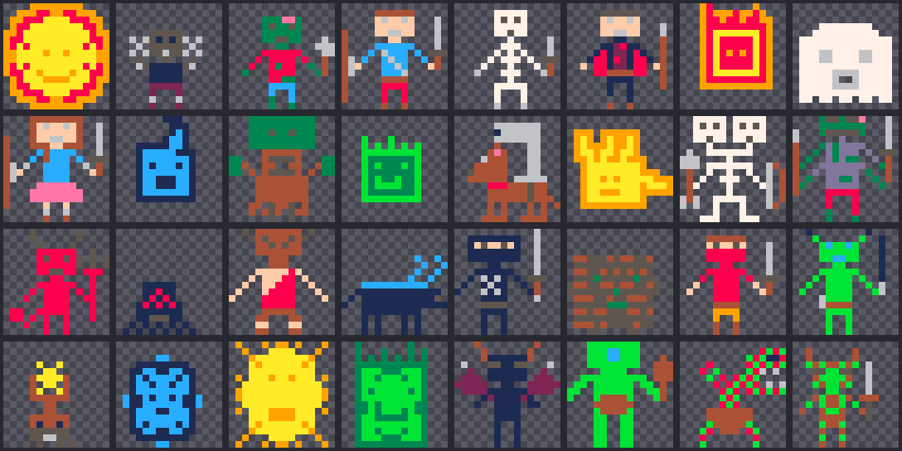

# La nuit des monstres

Un jeu de labyrinthe dans le navigateur : Steeve et son épée doivent chasser
tous les monstres de la nuit avant d'atteindre le portail.

**Jouer : https://monstres.oliviergg.fr**



Tous les sprites et la musique de l'écran titre ont été créés dans
[Sprite BASIC](https://github.com/Oliviergg/toy-basic), l'atelier de pixel art et
de mini-BASIC où le jeu a commencé. Le jeu a ensuite été réécrit en JavaScript
pour aller plus loin, en gardant les dessins, la palette de 16 couleurs, la police
3×5 et la mélodie d'origine.

## Comment jouer

| Touche | Action |
|---|---|
| Flèches ou ZQSD | bouger |
| Espace | coup d'épée |
| M | couper le son |
| P / Échap | pause |

- Le labyrinthe change à chaque partie et grandit à chaque niveau.
- Il fait nuit : on ne voit qu'autour de Steeve. La **torche** éclaire plus loin
  pendant 20 secondes.
- Certains monstres errent, d'autres flairent Steeve et le poursuivent. Le
  fantôme traverse les murs.
- Un monstre tué laisse parfois un **cœur**.
- Quand tous les monstres sont tués, le **portail** s'ouvre : il faut l'atteindre
  pour passer au niveau suivant.

## Le code

Pas de bibliothèque ni d'outil de build : un `index.html`, un `game.js`, un
`sprites.js`. Ouvrir `index.html` dans un navigateur suffit.

Le jeu dessine dans une image de 240×192 vrais pixels, que le navigateur agrandit
sans la lisser (`image-rendering: pixelated`).

| Fichier | Contenu |
|---|---|
| `game.js` | tout le jeu, en français : labyrinthe, monstres, nuit, sons, écrans |
| `sprites.js` | les 32 sprites, un caractère hexa par pixel (généré) |
| `outils/extraire-sprites.py` | régénère `sprites.js` depuis la sauvegarde cloud de Sprite BASIC |
| `deploy.sh` | publie sur monstres.oliviergg.fr |

### Ajouter un monstre

1. Le dessiner dans Sprite BASIC (projet « la nuit des monstres ») et sauvegarder.
2. `python3 outils/extraire-sprites.py`
3. Ajouter une ligne dans le tableau `MONSTRES` de `game.js` :
   ```js
   { spr: 25, nom: "œuf bleu", pv: 2, vit: 500, flair: 4, niveau: 3 },
   ```
   - `spr` : numéro du sprite
   - `pv` : nombre de coups d'épée pour le tuer
   - `vit` : millisecondes pour avancer d'une case (plus petit = plus rapide)
   - `flair` : à combien de cases il sent Steeve et le poursuit (0 = il erre au hasard)
   - `niveau` : à partir de quel niveau il apparaît
